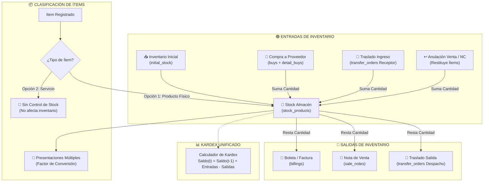
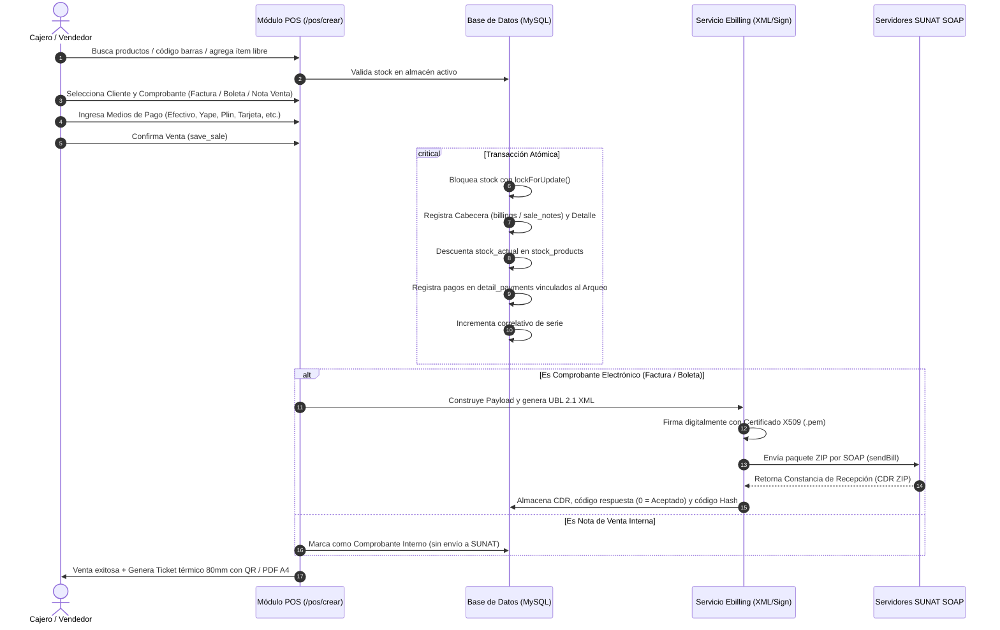
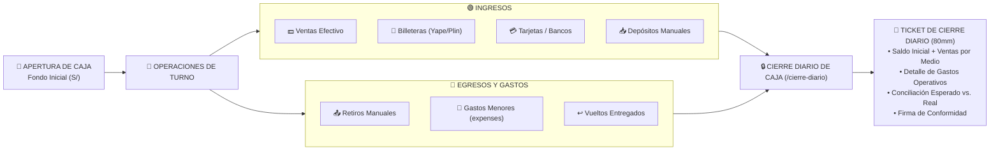
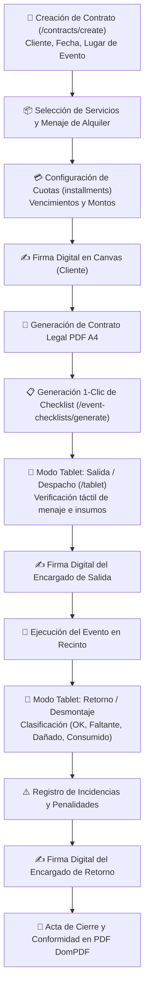
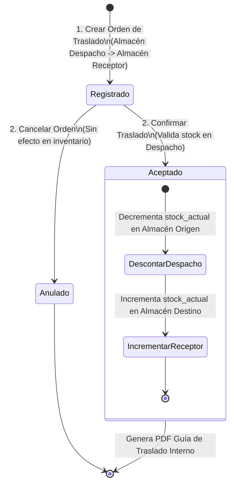
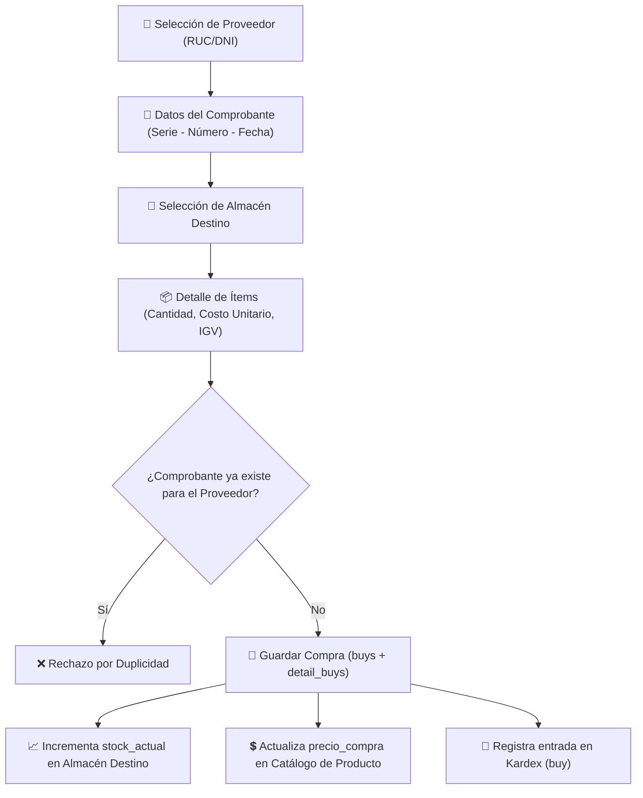

# SHIPIBO ERP - Sistema de Gestión Comercial, Control Multi-Almacén y Facturación Electrónica SUNAT

> **MYTEMS E.I.R.L. | Perú**  
> Sistema integral de gestión comercial, control de inventarios multi-almacén, punto de venta táctil (POS), arqueo y cierre diario de caja con control de gastos, compras, cotizaciones, gestión de contratos con firma digital y cronograma de cuotas, checklists operativos de eventos en modo Tablet, carta digital de coctelería y facturación electrónica UBL 2.1 conforme a la normativa SUNAT.

---

## Tabla de Contenidos

1. [Visión General del Sistema](#-visión-general-del-sistema)
2. [Arquitectura Tecnológica y Stack](#-arquitectura-tecnológica-y-stack)
3. [Especificaciones Funcionales de Módulos](#-especificaciones-funcionales-de-módulos)
   - [3.1. Configuración de Empresa Emisora (`/business`)](#31-configuración-de-empresa-emisora-business)
   - [3.2. Catálogos Maestros y Parámetros SUNAT](#32-catálogos-maestros-y-parámetros-sunat)
   - [3.3. Clientes y Proveedores](#33-clientes-y-proveedores)
   - [3.4. Productos, Presentaciones y Multi-Almacén](#34-productos-presentaciones-y-multi-almacén)
   - [3.5. Compras y Abastecimiento](#35-compras-y-abastecimiento)
   - [3.6. Punto de Venta Táctil (POS) e Ítems Personalizados](#36-punto-de-venta-táctil-pos-e-ítems-personalizados)
   - [3.7. Facturación Electrónica SUNAT UBL 2.1 (CPE, NC, ND)](#37-facturación-electrónica-sunat-ubl-21-cpe-nc-nd)
   - [3.8. Notas de Venta (Comprobante Interno)](#38-notas-de-venta-comprobante-interno)
   - [3.9. Guías de Remisión Electrónica (GRE Remitente)](#39-guías-de-remisión-electrónica-gre-remitente)
   - [3.10. Traslados entre Almacenes](#310-traslados-entre-almacenes)
   - [3.11. Kardex Físico y Valorado](#311-kardex-físico-y-valorado)
   - [3.12. Arqueo de Cajas y Cierre Diario con Gastos](#312-arqueo-de-cajas-y-cierre-diario-con-gastos)
   - [3.13. Cotizaciones y Proformas](#313-cotizaciones-y-proformas)
   - [3.14. Contratos de Servicios con Firma Digital y Cuotas](#314-contratos-de-servicios-con-firma-digital-y-cuotas)
   - [3.15. Checklists Operativos de Eventos en Modo Tablet](#315-checklists-operativos-de-eventos-en-modo-tablet)
   - [3.16. Menú de Cócteles y Carta Digital Táctil](#316-menú-de-cócteles-y-carta-digital-táctil)
   - [3.17. Conmutador de Establecimiento Activo (`/establishment`)](#317-conmutador-de-establecimiento-activo-establishment)
   - [3.18. Reportes Comerciales y Fiscales](#318-reportes-comerciales-y-fiscales)
   - [3.19. Endpoints API REST SUNAT](#319-endpoints-api-rest-sunat)
   - [📄 Documento PDR Oficial Completo (`docs/PDR_SISTEMA_COMPLETO.md`)](docs/PDR_SISTEMA_COMPLETO.md)
4. [Flujos de Procesos y Diagramas](#-flujos-de-procesos-y-diagramas)
   - [4.1. Flujo de Inventario y Kardex](#41-flujo-de-inventario-y-kardex)
   - [4.2. Flujo de Ventas y Emisión Fiscal (POS / CPE)](#42-flujo-de-ventas-y-emisión-fiscal-pos--cpe)
   - [4.3. Flujo de Caja, Arqueo y Cierre Diario con Gastos](#43-flujo-de-caja-arqueo-y-cierre-diario-con-gastos)
   - [4.4. Flujo de Contratos, Cuotas y Checklists en Tablet](#44-flujo-de-contratos-cuotas-y-checklists-en-tablet)
   - [4.5. Flujo de Traslado entre Almacenes](#45-flujo-de-traslado-entre-almacenes)
   - [4.6. Flujo de Compras y Costeo](#46-flujo-de-compras-y-costeo)
5. [Estructura del Proyecto y Base de Datos](#-estructura-del-proyecto-y-base-de-datos)
   - [5.1. Árbol de Directorios](#51-árbol-de-directorios)
   - [5.2. Catálogo de Modelos Eloquent (45 Modelos)](#52-catálogo-de-modelos-eloquent-45-modelos)
6. [Matriz Exhaustiva de Rutas, Controladores, Métodos y Vistas](#-matriz-exhaustiva-de-rutas-controladores-métodos-y-vistas)
7. [Instalación y Puesta en Marcha](#-instalación-y-puesta-en-marcha)
8. [Seguridad y Control de Accesos](#-seguridad-y-control-de-accesos)

---

## Visión General del Sistema

**Shipibo ERP** es una solución monolítica optimizada para pequeñas y medianas empresas peruanas (On-Premise / Single-Tenant), diseñada para eliminar redundancias operativas, garantizar la consistencia tributaria ante la SUNAT y ofrecer un control en tiempo real de inventarios, finanzas de caja, facturación y operaciones de campo (eventos y catering).

### Pilares del Sistema
* **Trazabilidad Total**: Cada movimiento físico (Kardex) o monetario (Caja) cuenta con registro de usuario, caja, almacén activo, fecha/hora y documento de respaldo.
* **Separación Estricta Producto vs. Servicio**: Los productos descuentan y suman inventario por almacén; los servicios no afectan el stock físico pero cumplen íntegramente la normativa fiscal del IGV.
* **Facturación Electrónica Nativa**: Generación y firmado digital XML-DSig de comprobantes UBL 2.1 en el servidor local con transmisión SOAP a SUNAT, recepción y descompresión de CDR oficial, sin costo por documento a proveedores externos.
* **Control Multi-Almacén y Multi-Caja**: Conmutador de establecimiento activo en sesión por usuario y series segregadas por caja.
* **Operatividad para Eventos y Catering**: Contratos formales con firma digital táctil, cuotas de pago con alertas, checklists de despacho/retorno con control de roturas/pérdidas en modo Tablet, y carta de coctelería touch.

---

## 🛠 Arquitectura Tecnológica y Stack

* **Backend**: PHP 8.2+ / 8.3.6 con Laravel 10.x.
* **Base de Datos**: MySQL 8.0+ / MariaDB 10.4+ Transaccional InnoDB con bloqueo pesimista `lockForUpdate()`.
* **Frontend**: Blade Templates, Vanilla JS / ES6 Modules, Bootstrap 5.x, DataTables, Select2, SweetAlert2, HTML5 Canvas para firmas digitales.
* **Facturación Electrónica (Ebilling)**:
  - Firma Digital XML-DSig (`.pem` / `.pfx` con certificado digital X509).
  - Generador UBL 2.1 XML (`InvoiceXmlBuilder` para Facturas `01`, Boletas `03`, Notas de Crédito `07` y Notas de Débito `08`).
  - Cliente SOAP nativo para WebServices de SUNAT (`sendBill` y consulta de CDR).
  - Cliente REST SUNAT con OAuth2 para Guías de Remisión Electrónica (GRE Remitente).
* **Generación de Documentos**: DomPDF configurado para rollos térmicos de 80mm (`[0, 0, 226.77, variable]`) y formatos A4 Portrait/Landscape.
* **Control de Acceso**: Spatie Laravel-Permission (Roles `SUPERADMIN`, `ADMIN`, `VENDEDOR`, `CAJERO`, `ALMACENERO`).
* **Importación y Exportación Masiva**: Soporte Excel para productos, inventarios y reportes fiscales.

---

## Especificaciones Funcionales de Módulos

### 3.1. Configuración de Empresa Emisora (`/business`)
* **Datos Fiscales**: RUC (11 dígitos), Razón Social (`MYTEMS E.I.R.L.`), Nombre Comercial, Dirección Fiscal, Ubigeo de 6 dígitos, Departamento, Provincia, Distrito, Teléfono, Correo.
* **Credenciales SUNAT**:
  - Usuario Secundario SOL y Clave SOL.
  - Certificado Digital (`.p12`/`.pfx` convertido a `.pem` con clave privada).
  - Client ID y Client Secret para API REST Guías de Remisión (GRE).
  - Entorno de trabajo conmutable: Modo Pruebas (Beta) / Modo Producción.
* **Branding**: Carga de logo corporativo utilizado dinámicamente en tickets térmicos de 80mm, contratos A4 y facturas.

### 3.2. Catálogos Maestros y Parámetros SUNAT
* **Tipos de Comprobante (`type_documents`)**: `01` Factura Electrónica, `03` Boleta de Venta, `02` Nota de Venta (Interna), `07` Nota de Crédito, `08` Nota de Débito, `09` Guía de Remisión Remitente.
* **Tipos de Documento de Identidad (`identity_document_types`)**: `1` DNI, `6` RUC, `4` Carnet de Extranjería, `7` Pasaporte, `0` No Domiciliado.
* **Tipos de Afectación al IGV (`igv_type_affections`)**: Catálogo 07 SUNAT (`10` Gravado Oneroso 18%, `20` Exonerado, `30` Inafecto, `40` Exportación).
* **Tipos de Nota de Crédito (`credit_note_types`)**: Catálogo 09 SUNAT (Anulación de operación, corrección por error en RUC, descuento global, etc.).
* **Tipos de Nota de Débito (`debit_note_types`)**: Catálogo 10 SUNAT (Intereses por mora, aumento de valor, penalidades).
* **Series y Correlativos (`series`)**: Vinculadas al tipo de comprobante, caja asignada (`idcaja`) y almacén activo.

### 3.3. Clientes y Proveedores
* **Gestión Centralizada**: Mantenimiento de clientes y proveedores con validación de tipo y número de documento.
* **Consulta en Línea RENIEC / SUNAT**: Conexión al servicio Factiliza API para autocompletar Razón Social / Nombres, condición y dirección fiscal desde DNI u 11 dígitos de RUC.
* **Validación Fiscal Estricta**: Impide la emisión de Facturas (`01`) a clientes que no cuenten con RUC (`6`) válido.

### 3.4. Productos, Presentaciones y Multi-Almacén
* **Clasificación del Ítem (`opcion`)**:
  - `1 - Producto Físico`: Descuenta stock por almacén en cada venta y salida; suma stock en compras y recepciones.
  - `2 - Servicio`: Ítem intangible, no gestiona inventario ni kardex, pero calcula IGV y se factura normativamente.
* **Herramientas de Alquiler / Retornables (`rentable` / `es_alquilable`)**:
  - Permite marcar productos como activos retornables para eventos (menaje, cristalería, barras, licuadoras) para auditar su retorno sin confundirlos con insumos consumibles.
* **Presentaciones y Unidades de Medida (`product_presentations`)**:
  - Permite asociar múltiples presentaciones a un producto (caja x 12, display x 24, botella 750ml, etc.) con factor de conversión para descuento automático exacto de stock.
* **Stock Fraccionario Decimal**:
  - Almacenamiento con 4 decimales (`decimal:4`) para insumos pesables o fraccionables (kg, gramos, litros).
* **Gestión Multi-Almacén (`warehouses`, `stock_products`)**:
  - Existencias segregadas por almacén, alertas de stock mínimo, importación y exportación masiva vía Excel (.xlsx).
  - Incremento rápido de stock con lector de código de barras (`barcode_sum`).

### 3.5. Compras y Abastecimiento
* **Ingreso de Mercadería (`/buys`)**:
  - Registro de compras a proveedores asociando tipo de comprobante, serie y correlativo del proveedor.
  - Validación anti-duplicados por `idproveedor` + `serie` + `correlativo`.
  - Actualización atómica en `stock_products` del almacén destino y actualización del costo referencial (`precio_compra`) en el catálogo.

### 3.6. Punto de Venta Táctil (POS) e Ítems Personalizados
* **Terminal POS Interactivo (`/pos/crear`)**:
  - Pantalla completa optimizada para pantallas táctiles y lectores de código de barras (`onScan`).
  - Búsqueda en tiempo real por descripción, código interno o código de barras.
  - **Ítems Personalizados al Vuelo (`add-custom-item`)**: Permite ingresar conceptos libres con descripción personalizada, unidad libre y precio, sin necesidad de registrarlos previamente en el catálogo.
  - Medios de pago múltiples: Efectivo con cálculo de vuelto, Yape, Plin, Tarjeta, Transferencia o combinaciones mixtas.
  - Ventas al contado y ventas al crédito con cronograma de cuotas.
  - Descuentos globales prorrateados de forma ponderada entre todos los ítems.
  - Emisión de ticket térmico de 80mm con código QR oficial SUNAT.

### 3.7. Facturación Electrónica SUNAT UBL 2.1 (CPE, NC, ND)
* **Emisión de Facturas (`01`) y Boletas (`03`)**: Generación de XML UBL 2.1, firmado digital XML-DSig, compresión ZIP, envío SOAP a SUNAT (`sendBill`) y almacenamiento del CDR (`R-*.zip`).
* **Submódulo de Notas de Crédito (`/billings/credit-notes`)**:
  - Creación de notas de crédito tipo `07` asociadas a una factura o boleta previa.
  - En anulaciones totales (tipo `01`), restitución automática del stock al almacén original.
* **Submódulo de Notas de Débito (`/billings/debit-notes`)**:
  - Creación de notas de débito tipo `08` para aumento de valor o penalidades.
* **Descarga de Archivos Tributarios**:
  - Descarga directa del archivo XML firmado (`GET /billings/{id}/xml`).
  - Descarga del CDR oficial de SUNAT (`GET /billings/{id}/cdr`).

### 3.8. Notas de Venta (Comprobante Interno)
* Comprobante administrativo para ventas internas sin validez tributaria ante SUNAT.
* Utiliza serie interna (`NV01`), descuenta stock físico exactamente igual que un comprobante fiscal, registra el cobro en el arqueo de caja e imprime ticket térmico de 80mm o PDF A4.

### 3.9. Guías de Remisión Electrónica (GRE Remitente)
* Emisión de Guías de Remisión Remitente (`09`) mediante el API REST oficial de SUNAT con OAuth2.
* Motivos de traslado: Venta, Traslado entre establecimientos de la misma empresa, Compra, Devolución.
* Modalidades: Transporte Privado (datos del vehículo y conductor con licencia) o Transporte Público (RUC de empresa transportista).
* Representación impresa en Ticket 80mm y PDF A4 con código QR.

### 3.10. Traslados entre Almacenes
* Órdenes de transferencia entre almacenes internos:
  - Fase Registrado / En Tránsito: Descuenta stock en almacén despacho.
  - Fase Confirmado / Aceptado: Suma stock en almacén receptor.
  - Fase Anulado: Cancela la orden sin impacto en existencias.
  - Impresión de guía de transferencia interna en PDF.

### 3.11. Kardex Físico y Valorado
* Registro unificado de entradas y salidas cronológicas con cálculo de saldo continuo (*Running Balance*).
* Tipos de movimiento integrados: `initial_stock`, `buy`, `transfer_in`, `sale_note`, `billing`, `transfer_out`.

### 3.12. Arqueo de Cajas y Cierre Diario con Gastos
* **Apertura de Turno (`/archingcash`)**: Fondo inicial de caja por usuario y almacén.
* **Operaciones durante el Turno**:
  - Ingresos por ventas en POS segregados por medio de pago (`detail_payments`).
  - Depósitos y retiros manuales de efectivo.
* **Control de Gastos Operativos Menores (`expenses`)**:
  - Registro de egresos menores con motivo, monto, comprobante, método de pago y beneficiario.
* **Cierre Diario de Caja Consolidado (`/archingcash/cierre-diario`)**:
  - Conciliación del saldo esperado versus el saldo físico contado en caja.
  - Clasificación de ventas: Pagadas, Pendientes, Devueltas, Anuladas.
  - Emisión de ticket térmico de 80mm con liquidación consolidada y firma del cajero.

### 3.13. Cotizaciones y Proformas
* Emisión de proformas comerciales con selección de clientes, productos y servicios.
* Impresión en formato A4 y Ticket con código QR, y envío automático por correo electrónico.
* **Conversión 1-Click a Venta**: Traslada automáticamente la cotización completa al carrito del POS para facturar de inmediato.

### 3.14. Contratos de Servicios con Firma Digital y Cuotas
* **Gestión Contractual Legal (`/contracts`)**:
  - Numeración correlativa anual (ej. `CON-2026-0001`).
  - Comparecencia de partes: El Prestador y El Cliente con datos fiscales completos.
  - Especificación del evento: Fecha, hora de inicio y recinto.
  - Editor dinámico de cláusulas legales con plantillas predefinidas y reordenamiento.
  - **Firma Digital**: Trazado directo en pantalla táctil/mouse mediante Canvas HTML5 o carga de imagen PNG/JPG.
  - **Cronograma de Cuotas Financieras (`contract_installments`)**: Desglose de pagos con porcentaje, monto, fecha de vencimiento, alertas de "Cuota Vencida" o "Vence Hoy", y amortización con registro de referencia (`POST /contracts/installments/{id}/pay`).
  - Enlace directo de 1 clic para generar el checklist operativo del evento.
  - Exportación formal en PDF A4.

### 3.15. Checklists Operativos de Eventos en Modo Tablet
* **Control Operativo de Campo (`/event-checklists`)**:
  - Generación automática a partir de cualquier contrato aprobado.
  - **Fase de Despacho (Salida)**: Checklist táctil de insumos y menaje cargados para el evento.
  - **Fase de Retorno (Desmontaje)**: Clasificación de cada ítem (`ok`, `faltante`, `daniado`, `quebrado`, `consumido`).
  - Asignación de penalidades y costos de reposición por ítems dañados o faltantes.
  - **Modo Tablet Touch (`/event-checklists/{id}/tablet`)**: Interfaz optimizada para supervisores en campo, con toggles táctiles de un solo toque y adición rápida de ítems.
  - Captura de firmas digitales de conformidad de los responsables de salida y retorno.
  - Emisión de reporte analítico y Acta de Conformidad en PDF.

### 3.16. Menú de Cócteles y Carta Digital Táctil
* **Carta Digital para Eventos y Barra (`/cocktail-menu`)**:
  - Administración de cócteles: Fotografía, cristalería recomendada, garnish, descripción de sabores, precio y vinculación opcional con productos tipo servicio (`opcion = 2`).
  - Categorías dinámicas (`cocktail_menu_categories`) y flags de "Cóctel de Autor" y "Destacado".
  - **Modo Tablet Táctil (`/cocktail-menu/tablet`)**: Experiencia visual tipo app táctil para exhibición en barra o mesas, con switch instantáneo para mostrar u ocultar precios según la modalidad del evento.

### 3.17. Conmutador de Establecimiento Activo (`/establishment`)
* Selector dinámico en la barra superior para alternar entre almacenes/locales autorizados para el usuario.
* Persiste la selección en sesión (`selected_warehouse_id`) y actualiza `users.idalmacen`, redireccionando de manera inteligente a la vista contextual correspondiente.

### 3.18. Reportes Comerciales y Fiscales
* **Registro de Ventas Oficial SUNAT (`/billings/reports/sales-register`)**: Reporte tributario consolidado con exportación a PDF y Excel.
* **Documentos Electrónicos Emitidos (`/billings/reports/billing-documents`)**: Monitoreo de comprobantes con CDR recibido, pendientes o rechazados.
* **Reporte de Notas de Crédito (`/billings/reports/credit-notes`)**: Auditoría de ajustes y devoluciones.
* **Ventas por Producto y Ventas por Medio de Pago (`/reportes/ventas`, `/reportes/pagos`)**: Analítica financiera por canal y rotación de ítems.

### 3.19. Endpoints API REST SUNAT
* `POST /api/sunat/validate`: Validador tributario de estructuras de comprobantes.
* `GET /api/sunat/billings/{billing}/payload`: Extracción del payload JSON UBL 2.1 para auditoría o consumo externo.
* `POST /api/sunat/billings/{billing}/dispatch`: Timbrado y transmisión a SUNAT mediante endpoint API REST.

---

## Flujos de Procesos y Diagramas

### 4.1. Flujo de Inventario y Kardex



---

### 4.2. Flujo de Ventas y Emisión Fiscal (POS / CPE)



---

### 4.3. Flujo de Caja, Arqueo y Cierre Diario con Gastos



---

### 4.4. Flujo de Contratos, Cuotas y Checklists en Tablet



---

### 4.5. Flujo de Traslado entre Almacenes



---

### 4.6. Flujo de Compras y Costeo



---

## 🗄 Estructura del Proyecto y Base de Datos

### 5.1. Árbol de Directorios
```text
├── app/
│   ├── Console/
│   │   └── Kernel.php              # Programación de tareas
│   ├── Exceptions/
│   │   └── Handler.php             # Manejo centralizado de excepciones
│   ├── Exports/                    # Clases de exportación Excel
│   │   ├── AllProductsExport.php
│   │   ├── BillingReportExport.php
│   │   ├── ProductsCatalogExport.php
│   │   └── ProductsWarehouseExport.php
│   ├── Http/
│   │   ├── Controllers/
│   │   │   ├── Api/                # Endpoints REST SUNAT
│   │   │   │   ├── SunatBillingPayloadController.php
│   │   │   │   ├── SunatDispatchController.php
│   │   │   │   └── SunatValidationController.php
│   │   │   ├── ArchingCashController.php       # Arqueos y turnos de caja
│   │   │   ├── BillingController.php           # Facturas, Boletas, NC, ND, XML y CDR
│   │   │   ├── BillingReportController.php     # Registro de ventas, documentos y NC
│   │   │   ├── BusinessController.php          # Datos de empresa y credenciales SUNAT
│   │   │   ├── BuyController.php               # Compras a proveedores
│   │   │   ├── CashController.php              # Cajas físicas
│   │   │   ├── CategoryController.php          # Categorías de productos
│   │   │   ├── ClientController.php            # Clientes y consulta RENIEC/SUNAT
│   │   │   ├── CocktailMenuController.php      # Menú de cócteles y carta digital tablet
│   │   │   ├── ContractController.php          # Contratos de servicios, cuotas y firmas
│   │   │   ├── Controller.php                  # Controlador base con helpers de almacén
│   │   │   ├── CountryController.php           # Países y monedas
│   │   │   ├── DailyCashClosingController.php  # Cierre diario de caja y control de gastos
│   │   │   ├── EventChecklistController.php    # Checklists de eventos en modo tablet
│   │   │   ├── HomeController.php              # Dashboard principal y analítica
│   │   │   ├── KardexController.php            # Kardex físico y valorado
│   │   │   ├── LoginController.php             # Autenticación de usuarios
│   │   │   ├── PayModeController.php           # Medios de pago
│   │   │   ├── PosController.php               # Punto de venta táctil e ítems custom
│   │   │   ├── ProductController.php           # Catálogo, presentaciones y stock
│   │   │   ├── ProviderController.php          # Directorio de proveedores
│   │   │   ├── QuoteController.php             # Cotizaciones y conversión a venta
│   │   │   ├── ReportPaymentController.php     # Reporte por medio de pago
│   │   │   ├── ReportSalesController.php       # Reporte de ventas general y por producto
│   │   │   ├── RoleController.php              # Roles y permisos Spatie
│   │   │   ├── SaleNoteController.php          # Notas de venta internas
│   │   │   ├── SerieController.php             # Series y correlativos por caja
│   │   │   ├── ShipmentGuideController.php     # Guías de Remisión Electrónica GRE
│   │   │   ├── TransferOrderController.php     # Traslados entre almacenes
│   │   │   ├── UserController.php              # Usuarios y asignación de cajas
│   │   │   ├── WarehouseController.php         # Almacenes e inventarios
│   │   │   └── WarehouseSelectorController.php # Conmutador de establecimiento activo
│   │   ├── Middleware/                         # Middlewares de aplicación
│   │   └── Requests/                           # Form Requests de validación
│   │       └── ProductImportRequest.php
│   ├── Imports/                                # Clases de importación Excel
│   │   ├── ProductsCatalogImport.php
│   │   └── ProductsWarehouseImport.php
│   ├── Models/                                 # 45 Modelos Eloquent
│   └── Services/
│       └── Ebilling/                           # Motor nativo de facturación electrónica UBL 2.1
│           ├── Cdr/CdrParser.php               # Extractor y analizador de CDR
│           ├── Payload/BillingPayloadBuilder.php # Constructor del payload UBL
│           ├── Signing/XmlSigner.php           # Firmador digital XML-DSig
│           ├── Support/                        # Paths, endpoints y perfiles de emisor
│           ├── Transport/SunatSoapClient.php   # Cliente WebService SOAP SUNAT
│           ├── Validation/PayloadValidator.php # Validador tributario
│           ├── Xml/InvoiceXmlBuilder.php       # Renderizador de XML UBL 2.1
│           └── SunatDispatchService.php        # Orquestador del despacho a SUNAT
├── database/
│   ├── migrations/                             # 63 migraciones estructuradas
│   └── seeders/                                # Semilleros iniciales
├── docs/
│   ├── PDR_SISTEMA_COMPLETO.md                 # Documento Oficial PDR v3.0.0
│   └── PRD_MODULOS_PENDIENTES_FE.md            # Histórico de requerimientos
├── public/
│   └── files/                                  # Almacenamiento de XML, CDR, PDFs y firmas
├── resources/
│   └── views/                                  # 100+ Plantillas Blade
└── routes/
    ├── web.php                                 # 280+ rutas web de la aplicación
    └── api.php                                 # Rutas de API REST SUNAT
```

---

### 5.2. Catálogo de Modelos Eloquent (45 Modelos)

| # | Modelo | Tabla | Propósito y Relaciones Clave |
| :---: | :--- | :--- | :--- |
| 1 | `ArchingCash` | `arching_cashes` | Sesiones de arqueo y apertura/cierre de turnos de caja (`cash`, `user`, `warehouse`). |
| 2 | `Billing` | `billings` | Comprobantes electrónicos UBL 2.1 (`customer`, `currency`, `typeDocument`, `payMode`, `detail`). |
| 3 | `Business` | `businesses` | Perfil de empresa emisora, certificado digital, credenciales SOL y GRE. |
| 4 | `Buy` | `buys` | Compras a proveedores e ingreso formal de mercadería (`provider`, `warehouse`, `user`, `details`). |
| 5 | `Cash` | `cashes` | Cajas físicas del sistema vinculadas a usuarios y series. |
| 6 | `Category` | `categories` | Clasificación de productos en el catálogo. |
| 7 | `Client` | `clients` | Directorio de clientes y proveedores con validación de documento (`tipoDocumento`, `contracts`). |
| 8 | `CocktailMenuCategory` | `cocktail_menu_categories` | Categorías de la carta de coctelería para eventos y barra (`items`, `activeItems`). |
| 9 | `CocktailMenuItem` | `cocktail_menu_items` | Cócteles de la carta con receta, cristalería, foto, autor y destacado (`category`, `product`). |
| 10 | `Contract` | `contracts` | Contratos de prestación de servicios y catering (`client`, `clauses`, `items`, `installments`, `checklists`). |
| 11 | `ContractClause` | `contract_clauses` | Cláusulas legales dinámicas reordenables por contrato. |
| 12 | `ContractInstallment` | `contract_installments` | Cuotas del cronograma financiero del contrato con fechas y estado (`contract`). |
| 13 | `ContractItem` | `contract_items` | Servicios, insumos y menaje cotizados en el contrato (`contract`, `product`). |
| 14 | `Country` | `countries` | Países, moneda oficial (`SOLES`), símbolo (`S/`) y código telefónico. |
| 15 | `CreditNoteType` | `credit_note_types` | Catálogo 09 SUNAT de tipos de Nota de Crédito. |
| 16 | `Currency` | `currencies` | Monedas soportadas (PEN, USD). |
| 17 | `DebitNoteType` | `debit_note_types` | Catálogo 10 SUNAT de tipos de Nota de Débito. |
| 18 | `Department` | `departments` | Departamentos del Perú para Ubigeo oficial. |
| 19 | `DetailBilling` | `detail_billings` | Detalle de comprobantes electrónicos con soporte para ítems personalizados (`billing`, `product`, `igvTypeAffection`). |
| 20 | `DetailBuy` | `detail_buys` | Detalle de compra de mercadería con costo unitario y almacén destino. |
| 21 | `DetailPayment` | `detail_payments` | Desglose transaccional de pagos por venta vinculados al arqueo (`payMode`). |
| 22 | `DetailQuote` | `detail_quotes` | Detalle de ítems cotizados en proformas comerciales. |
| 23 | `DetailSaleNote` | `detail_sale_notes` | Detalle de ítems en notas de venta internas con soporte para ítems custom. |
| 24 | `DetailTransferOrder` | `detail_transfer_orders` | Detalle de productos trasladados entre almacenes. |
| 25 | `District` | `districts` | Distritos y códigos Ubigeo de 6 dígitos. |
| 26 | `EventChecklist` | `event_checklists` | Checklists operativos de salida y retorno para eventos (`contract`, `items`). |
| 27 | `EventChecklistItem` | `event_checklist_items` | Ítems de menaje auditados en el evento con estados (OK, Faltante, Dañado) y penalidades. |
| 28 | `Expense` | `expenses` | Gastos y egresos menores registrados en el Cierre Diario (`archingCash`, `cash`, `warehouse`, `user`). |
| 29 | `IdentityDocumentType` | `identity_document_types` | Tipos de documento de identidad fiscal (DNI, RUC, CE, Pasaporte). |
| 30 | `IgvTypeAffection` | `igv_type_affections` | Catálogo 07 SUNAT de afectación al IGV (10, 20, 30, 40). |
| 31 | `PayMode` | `pay_modes` | Métodos de pago registrados (Efectivo, Tarjeta, Yape, Plin, Transferencia). |
| 32 | `Product` | `products` | Maestro de productos y servicios (`unit`, `category`, `igvTypeAffection`, `presentations`, `stockProducts`). |
| 33 | `ProductPresentation` | `product_presentations` | Presentaciones múltiples por producto con factor de conversión y precios diferenciados (`product`, `unit`). |
| 34 | `Provider` | `providers` | Proveedores para compras y abastecimiento. |
| 35 | `Province` | `provinces` | Provincias de la división territorial de Perú. |
| 36 | `Quote` | `quotes` | Cotizaciones y proformas comerciales numeradas (`client`, `details`). |
| 37 | `SaleNote` | `sale_notes` | Notas de venta de control interno con serie `NV01` (`usuario`, `pago`, `cliente`). |
| 38 | `Serie` | `series` | Series y correlativos atómicos por caja y tipo de documento (`cash`, `typeDocument`). |
| 39 | `ShipmentGuide` | `shipment_guides` | Guías de remisión electrónica GRE Remitente (`client`, `items`). |
| 40 | `ShipmentGuideItem` | `shipment_guide_items` | Ítems físicos amparados en la guía de remisión electrónica. |
| 41 | `StockProduct` | `stock_products` | Existencias físicas, stock mínimo y costo por almacén (`product`, `warehouse`). |
| 42 | `TransferOrder` | `transfer_orders` | Órdenes de transferencia física entre almacenes (`details`, `warehouse`). |
| 43 | `TypeDocument` | `type_documents` | Tipos de comprobante fiscal y administrativo (01, 03, 02, 07, 08, 09). |
| 44 | `Unit` | `units` | Unidades de medida oficiales SUNAT (NIU, KGM, LTR, ZZ, etc.). |
| 45 | `User` | `users` | Usuarios del sistema con roles Spatie, caja asignada (`cash`) y almacén activo (`activeWarehouse`). |
| 46 | `Warehouse` | `warehouses` | Almacenes físicos y virtuales de la empresa. |

---

## 🗺 Matriz Exhaustiva de Rutas, Controladores, Métodos y Vistas

El sistema cuenta con más de 280 rutas registradas. A continuación se resume la matriz de endpoints y controladores:

### 1. Autenticación y Conmutador de Establecimiento
* `GET /` &bull; `LoginController@index` &bull; Nombre: `login` &bull; Vista: `resources/views/login.blade.php`
* `POST /login/login` &bull; `LoginController@login` &bull; Nombre: `login.login`
* `GET /login/logout` &bull; `LoginController@logout` &bull; Nombre: `login.logout`
* `GET /home` &bull; `HomeController@index` &bull; Nombre: `admin.home` &bull; Vista: `resources/views/admin/home.blade.php`
* `GET /home/ventas-mensuales` &bull; `HomeController@ventasMensuales` &bull; Nombre: `home.ventas_mensuales`
* `GET /home/reporte-ingresos` &bull; `HomeController@reporteIngresos` &bull; Nombre: `home.reporte_ingresos`
* `GET /home/metodo-pagos` &bull; `HomeController@metodosPagoVentas` &bull; Nombre: `home.metodo_pagos`
* `GET /establishment` &bull; `WarehouseSelectorController@index` &bull; Nombre: `warehouse.selector.index` &bull; Vista: `resources/views/establishment.blade.php`
* `POST /establishment/select` &bull; `WarehouseSelectorController@store` &bull; Nombre: `warehouse.selector.store`

### 2. Configuración Fiscal y Parámetros
* `GET /business` &bull; `BusinessController@index` &bull; Nombre: `admin.business` &bull; Vista: `resources/views/admin/business/home.blade.php`
* `POST /business/load-ubigeo` &bull; `BusinessController@load_ubigeo`
* `POST /business/load-provinces` &bull; `BusinessController@load_provinces`
* `POST /business/load-districts` &bull; `BusinessController@load_districts`
* `POST /business/load-logo` &bull; `BusinessController@load_logo`
* `POST /business/save-info` &bull; `BusinessController@save_info`
* `POST /business/save-sunat` &bull; `BusinessController@save_sunat`
* `CRUD /cashes` &bull; `CashController` (`index`, `get`, `save`, `detail`, `store`, `delete`) &bull; Vista: `resources/views/admin/cashes/list.blade.php`
* `CRUD /pay-modes` &bull; `PayModeController` (`index`, `get`, `save`, `detail`, `store`, `delete`) &bull; Vista: `resources/views/admin/paymodes/list.blade.php`
* `CRUD /series` &bull; `SerieController` (`index`, `get`, `save`, `detail`, `store`, `delete`) &bull; Vista: `resources/views/admin/series/list.blade.php`
* `CRUD /countries` &bull; `CountryController` (`index`, `get`, `save`, `detail`, `store`, `delete`) &bull; Vista: `resources/views/admin/countries/list.blade.php`
* `CRUD /categories` &bull; `CategoryController` (`index`, `get`, `save`, `detail`, `store`, `delete`) &bull; Vista: `resources/views/admin/categories/list.blade.php`

### 3. Clientes, Proveedores y Usuarios
* `CRUD /clients` &bull; `ClientController` (`index`, `get`, `searchDocument`, `save`, `detail`, `store`, `delete`) &bull; Vista: `resources/views/admin/clients/list.blade.php`
* `CRUD /providers` &bull; `ProviderController` (`index`, `get`, `searchDocument`, `save`, `detail`, `store`, `delete`) &bull; Vista: `resources/views/admin/providers/list.blade.php`
* `CRUD /users` &bull; `UserController` (`index`, `get`, `save`, `detail`, `store`, `delete`, `view_role`, `update`) &bull; Vista: `resources/views/admin/users/list.blade.php`
* `CRUD /roles` &bull; `RoleController` (`index`, `get`, `save`, `detail`, `store`, `delete`) &bull; Vista: `resources/views/admin/roles/list.blade.php`

### 4. Productos, Almacenes y Kardex
* `CRUD /products` &bull; `ProductController`:
  - `GET /products` &bull; Nombre: `admin.products` &bull; Vista: `resources/views/admin/products/list.blade.php`
  - `GET /products/get` &bull; Nombre: `products.get`
  - `POST /products/save` &bull; `ProductController@save`
  - `POST /products/detail` &bull; `ProductController@detail`
  - `POST /products/view-detail` &bull; `ProductController@view_detail`
  - `POST /products/store` &bull; `ProductController@store`
  - `POST /products/delete` &bull; `ProductController@delete`
  - `POST /products/bulk-delete` &bull; `ProductController@bulkDelete`
  - `POST /products/save-presentations` &bull; `ProductController@savePresentations`
  - `GET /products/download-excel` &bull; `ProductController@download`
  - `GET /products/export-all-excel` &bull; `ProductController@exportAllExcel` &bull; Vista: `resources/views/admin/products/export_all_excel.blade.php`
  - `POST /products/upload-excel` &bull; `ProductController@upload`
* `CRUD /warehouses` &bull; `WarehouseController`:
  - `GET /warehouses` &bull; Nombre: `admin.warehouses` &bull; Vista: `resources/views/admin/warehouses/list.blade.php`
  - `GET /warehouses/{id}` &bull; Nombre: `admin.products_warehouse` &bull; Vista: `resources/views/admin/warehouses/products/list.blade.php`
  - `POST /warehouses/list` &bull; `WarehouseController@list_products`
  - `POST /warehouses/get-prod-warehouse` &bull; `WarehouseController@get_prod_warehouse`
  - `POST /warehouses/save-product` &bull; `WarehouseController@save_product_stock`
  - `POST /warehouses/barcode_sum` &bull; `WarehouseController@barcode_sum`
  - `POST /warehouses/sum-stock` &bull; `WarehouseController@sum_stock`
  - `POST /warehouses/store-stock` &bull; `WarehouseController@store_stock`
  - `POST /warehouses/delete-stock` &bull; `WarehouseController@delete_stock`
  - `GET /warehouses/export-products/{id}` &bull; `WarehouseController@export_products`
  - `POST /warehouses/upload-excel` &bull; `WarehouseController@upload_excel_products`
* `GET /kardex` &bull; `KardexController@index` &bull; Nombre: `admin.kardex` &bull; Vista: `resources/views/admin/kardex/index.blade.php`

### 5. Compras y Cotizaciones
* `Módulo /buys` &bull; `BuyController`:
  - `GET /buys` &bull; Nombre: `admin.buys` &bull; Vista: `resources/views/admin/buys/list.blade.php`
  - `GET /buys/create` &bull; Nombre: `admin.create_buy` &bull; Vista: `resources/views/admin/buys/create.blade.php`
  - `POST /buys/save` &bull; Nombre: `admin.save_buy`
  - `POST /buys/load-cart` &bull; `BuyController@load_cart`
  - `POST /buys/print-buy` &bull; `BuyController@print` &bull; Vista: `resources/views/admin/buys/pdf.blade.php`
* `Módulo /quotes` &bull; `QuoteController`:
  - `GET /quotes` &bull; Nombre: `admin.quotes` &bull; Vista: `resources/views/admin/quotes/list.blade.php`
  - `GET /quotes/create` &bull; Nombre: `admin.create_quote` &bull; Vista: `resources/views/admin/quotes/create.blade.php`
  - `GET /quotes/q{id}` &bull; Nombre: `admin.edit_quote` &bull; Vista: `resources/views/admin/quotes/edit.blade.php`
  - `GET /quotes/q{id}/convert-sale` &bull; Nombre: `admin.convert_quote_to_sale`
  - `POST /quotes/save` &bull; Nombre: `admin.save_quote`
  - `POST /quotes/print-a4` &bull; `QuoteController@print_a4` &bull; Vista: `resources/views/admin/quotes/pdf.blade.php`
  - `POST /quotes/print-ticket` &bull; `QuoteController@print_ticket`
  - `POST /quotes/send-mail` &bull; `QuoteController@send_mail`

### 6. Contratos de Servicios, Checklists y Cócteles
* `Módulo /contracts` &bull; `ContractController`:
  - `GET /contracts` &bull; Nombre: `admin.contracts` &bull; Vista: `resources/views/admin/contracts/list.blade.php`
  - `GET /contracts/create` &bull; Nombre: `admin.create_contract` &bull; Vista: `resources/views/admin/contracts/create.blade.php`
  - `POST /contracts/store` &bull; Nombre: `admin.store_contract`
  - `GET /contracts/{id}/edit` &bull; Nombre: `admin.edit_contract` &bull; Vista: `resources/views/admin/contracts/edit.blade.php`
  - `POST /contracts/{id}/update` &bull; Nombre: `admin.update_contract`
  - `POST /contracts/delete` &bull; Nombre: `admin.delete_contract`
  - `POST /contracts/detail` &bull; Nombre: `admin.detail_contract`
  - `POST /contracts/print-a4` &bull; Nombre: `admin.print_contract_a4` &bull; Vista: `resources/views/admin/contracts/pdf.blade.php`
  - `GET /contracts/{id}/download` &bull; Nombre: `admin.contracts.download`
  - `POST /contracts/installments/{id}/pay` &bull; Nombre: `admin.contracts.pay_installment`
* `Módulo /event-checklists` &bull; `EventChecklistController`:
  - `GET /event-checklists` &bull; Nombre: `admin.event_checklists` &bull; Vista: `resources/views/admin/event_checklists/index.blade.php`
  - `GET /event-checklists/get` &bull; Nombre: `event_checklists.get`
  - `GET /event-checklists/contract/{contractId}/generate` &bull; Nombre: `admin.event_checklists.generate`
  - `GET /event-checklists/{id}/tablet` &bull; Nombre: `admin.event_checklists.tablet` &bull; Vista: `resources/views/admin/event_checklists/tablet.blade.php`
  - `POST /event-checklists/{id}/update-item` &bull; Nombre: `admin.event_checklists.update_item`
  - `POST /event-checklists/{id}/add-item` &bull; Nombre: `admin.event_checklists.add_item`
  - `POST /event-checklists/{id}/bulk-toggle` &bull; Nombre: `admin.event_checklists.bulk_toggle`
  - `GET /event-checklists/{id}/report` &bull; Nombre: `admin.event_checklists.report` &bull; Vista: `resources/views/admin/event_checklists/report.blade.php`
  - `GET /event-checklists/{id}/pdf` &bull; Nombre: `admin.event_checklists.pdf` &bull; Vista: `resources/views/admin/event_checklists/pdf.blade.php`
  - `POST /event-checklists/delete` &bull; Nombre: `admin.event_checklists.delete`
* `Módulo /cocktail-menu` &bull; `CocktailMenuController`:
  - `GET /cocktail-menu` &bull; Nombre: `admin.cocktail_menu.index` &bull; Vista: `resources/views/admin/cocktail_menu/index.blade.php`
  - `GET /cocktail-menu/get` &bull; Nombre: `admin.cocktail_menu.get`
  - `POST /cocktail-menu/detail` &bull; Nombre: `admin.cocktail_menu.detail`
  - `POST /cocktail-menu/store` &bull; Nombre: `admin.cocktail_menu.store`
  - `POST /cocktail-menu/delete` &bull; Nombre: `admin.cocktail_menu.delete`
  - `POST /cocktail-menu/toggle-status` &bull; Nombre: `admin.cocktail_menu.toggle_status`
  - `POST /cocktail-menu/store-category` &bull; Nombre: `admin.cocktail_menu.store_category`
  - `POST /cocktail-menu/delete-category` &bull; Nombre: `admin.cocktail_menu.delete_category`
  - `GET /cocktail-menu/tablet` &bull; Nombre: `admin.cocktail_menu.tablet` &bull; Vista: `resources/views/admin/cocktail_menu/tablet.blade.php`

### 7. Punto de Venta (POS) y Notas de Venta
* `Módulo /pos` &bull; `PosController`:
  - `GET /pos` &bull; Nombre: `admin.pos` &bull; Vista: `resources/views/admin/pos/list.blade.php`
  - `GET /pos/crear` &bull; Nombre: `admin.pos.create` &bull; Vista: `resources/views/admin/pos/home.blade.php`
  - `GET /pos/get` &bull; Nombre: `admin.pos.get`
  - `POST /pos/search-product` &bull; Nombre: `admin.search_product_pos`
  - `POST /pos/add-product-search` &bull; Nombre: `admin.add_product_search`
  - `POST /pos/add-product-barcode` &bull; Nombre: `admin.add_product_barcode`
  - `POST /pos/load-cart` &bull; Nombre: `admin.load_cart_pos`
  - `POST /pos/add-product` &bull; Nombre: `admin.add_product_pos`
  - `POST /pos/delete-product` &bull; Nombre: `admin.delete_product_pos`
  - `POST /pos/clear-cart` &bull; Nombre: `admin.clear_cart_pos`
  - `POST /pos/store-product` &bull; Nombre: `admin.store_product_pos`
  - `POST /pos/open-modal` &bull; Nombre: `pos.open_modal_confirm`
  - `POST /pos/save-sale` &bull; Nombre: `pos.save_sale`
  - `POST /pos/search-units` &bull; Nombre: `pos.search_units`
  - `POST /pos/add-custom-item` &bull; Nombre: `pos.add_custom_item`
  - `POST /pos/delete-custom-item` &bull; Nombre: `pos.delete_custom_item`
* `Módulo /salenotes` &bull; `SaleNoteController`:
  - `GET /salenotes` &bull; Nombre: `admin.sale_notes` &bull; Vista: `resources/views/admin/sale_notes/list.blade.php`
  - `GET /salenotes/get` &bull; Nombre: `sale_notes.get`
  - `POST /salenotes/print-ticket` &bull; `SaleNoteController@print_ticket` &bull; Vista: `resources/views/admin/pos/ticket_sn.blade.php`
  - `POST /salenotes/print-a4` &bull; `SaleNoteController@print_a4` &bull; Vista: `resources/views/admin/sale_notes/pdf.blade.php`
  - `POST /salenotes/send-mail` &bull; `SaleNoteController@send_mail`
  - `POST /salenotes/anulled` &bull; `SaleNoteController@anulled`

### 8. Facturación Electrónica UBL 2.1 y Guías GRE
* `Módulo /billings` &bull; `BillingController`:
  - `GET /billings` &bull; Nombre: `admin.billings` &bull; Vista: `resources/views/admin/billings/list.blade.php`
  - `GET /billings/get` &bull; Nombre: `billings.get`
  - `GET /billings/credit-notes` &bull; Nombre: `admin.billing_credit_notes` &bull; Vista: `resources/views/admin/billings/credit_notes_list.blade.php`
  - `GET /billings/credit-notes/get` &bull; Nombre: `billings.credit_notes.get`
  - `GET /billings/debit-notes` &bull; Nombre: `admin.billing_debit_notes` &bull; Vista: `resources/views/admin/billings/debit_notes_list.blade.php`
  - `GET /billings/debit-notes/get` &bull; Nombre: `billings.debit_notes.get`
  - `POST /billings/{id}/credit-note` &bull; Nombre: `admin.create_credit_note_billing`
  - `POST /billings/{id}/debit-note` &bull; Nombre: `admin.create_debit_note_billing`
  - `POST /billings/print-ticket` &bull; `BillingController@print_ticket` &bull; Vista: `resources/views/admin/pos/ticket_document.blade.php`
  - `POST /billings/print-a4` &bull; `BillingController@print_a4`
  - `GET /billings/{id}/xml` &bull; Nombre: `admin.billing_xml`
  - `GET /billings/{id}/cdr` &bull; Nombre: `admin.billing_cdr`
  - `POST /billings/{id}/dispatch` &bull; Nombre: `admin.dispatch_billing`
* `Módulo /shipment-guides` &bull; `ShipmentGuideController`:
  - `GET /shipment-guides` &bull; Nombre: `admin.shipment_guides` &bull; Vista: `resources/views/admin/shipment_guides/list.blade.php`
  - `GET /shipment-guides/create` &bull; Nombre: `admin.create_shipment_guide` &bull; Vista: `resources/views/admin/shipment_guides/create.blade.php`
  - `GET /shipment-guides/get` &bull; Nombre: `shipment_guides.get`
  - `GET /shipment-guides/search-ubigeo` &bull; Nombre: `admin.search_shipment_guide_ubigeo`
  - `POST /shipment-guides/save` &bull; Nombre: `admin.save_shipment_guide`
  - `POST /shipment-guides/detail` &bull; Nombre: `admin.detail_shipment_guide`
  - `POST /shipment-guides/print-ticket` &bull; `ShipmentGuideController@print_ticket` &bull; Vista: `resources/views/admin/shipment_guides/ticket.blade.php`
  - `POST /shipment-guides/print-a4` &bull; `ShipmentGuideController@print_a4` &bull; Vista: `resources/views/admin/shipment_guides/pdf.blade.php`
* `Módulo /transferorders` &bull; `TransferOrderController`:
  - `GET /transferorders` &bull; Nombre: `admin.transfer_orders` &bull; Vista: `resources/views/admin/transfer_orders/list.blade.php`
  - `GET /transferorders/create` &bull; Nombre: `admin.create_transfer_order` &bull; Vista: `resources/views/admin/transfer_orders/create.blade.php`
  - `GET /transferorders/get-transfer-orders` &bull; Nombre: `admin.get_transfer_orders`
  - `POST /transferorders/save-transfer` &bull; Nombre: `admin.save_transfer`
  - `POST /transferorders/move-transfer` &bull; Nombre: `admin.move_transfer`
  - `POST /transferorders/print-transfer` &bull; Nombre: `admin.print_transfer` &bull; Vista: `resources/views/admin/transfer_orders/pdf.blade.php`

### 9. Arqueo de Caja y Cierre Diario de Caja con Gastos
* `Módulo /archingcash` &bull; `ArchingCashController`:
  - `GET /archingcash` &bull; Nombre: `admin.arching_cashes` &bull; Vista: `resources/views/admin/arching_cashes/list.blade.php`
  - `GET /archingcash/get` &bull; Nombre: `arching_cashes.get`
  - `POST /archingcash/save` &bull; Nombre: `arching_cash.save`
  - `POST /archingcash/close` &bull; Nombre: `admin.close_cash`
  - `POST /archingcash/save-deposit` &bull; Nombre: `admin.save_deposit`
  - `POST /archingcash/save-withdrawal` &bull; Nombre: `admin.save_withdrawal`
  - `POST /archingcash/print-summary` &bull; Nombre: `admin.print_summary` &bull; Vista: `resources/views/admin/arching_cashes/ticket.blade.php`
* `Módulo /archingcash/cierre-diario` &bull; `DailyCashClosingController`:
  - `GET /archingcash/cierre-diario` &bull; Nombre: `admin.daily_closing` &bull; Vista: `resources/views/admin/arching_cashes/daily_closing.blade.php`
  - `GET /archingcash/cierre-diario/ventas-data` &bull; Nombre: `admin.daily_closing.sales_data`
  - `GET /archingcash/cierre-diario/gastos-data` &bull; Nombre: `admin.daily_closing.expenses_data`
  - `POST /archingcash/cierre-diario/gastos/guardar` &bull; Nombre: `admin.daily_closing.store_expense`
  - `POST /archingcash/cierre-diario/gastos/anular` &bull; Nombre: `admin.daily_closing.delete_expense`
  - `POST /archingcash/cierre-diario/cerrar` &bull; Nombre: `admin.daily_closing.close_cash`
  - `GET /archingcash/cierre-diario/imprimir` &bull; Nombre: `admin.daily_closing.print_ticket` &bull; Vista: `resources/views/admin/arching_cashes/daily_closing_ticket.blade.php`

### 10. Reportes Comerciales y Tributarios
* `Módulo /billings/reports` &bull; `BillingReportController`:
  - `GET /billings/reports/sales-register` &bull; Nombre: `report.billings.sales_register` &bull; Vista: `resources/views/admin/reports/billings/sales_register.blade.php`
  - `GET /billings/reports/sales-register/data` &bull; Nombre: `report.billings.sales_register.data`
  - `GET /billings/reports/sales-register/pdf` &bull; Nombre: `report.billings.sales_register.pdf` &bull; Vista: `resources/views/admin/reports/billings/pdf.blade.php`
  - `GET /billings/reports/sales-register/excel` &bull; Nombre: `report.billings.sales_register.excel` &bull; Vista: `resources/views/admin/reports/billings/excel.blade.php`
  - `GET /billings/reports/billing-documents` &bull; Nombre: `report.billings.billing_documents` &bull; Vista: `resources/views/admin/reports/billings/billing_documents.blade.php`
  - `GET /billings/reports/credit-notes` &bull; Nombre: `report.billings.credit_notes` &bull; Vista: `resources/views/admin/reports/billings/credit_notes.blade.php`
* `Módulo /reportes` &bull; `ReportSalesController` & `ReportPaymentController`:
  - `GET /reportes/ventas` &bull; Nombre: `report.sales.index` &bull; Vista: `resources/views/admin/reports/sales/index.blade.php`
  - `GET /by-product` &bull; Nombre: `report.sales.by_product.index` &bull; Vista: `resources/views/admin/reports/sales/sales_product.blade.php`
  - `GET /reportes/pagos` &bull; Nombre: `report.payments.index` &bull; Vista: `resources/views/admin/reports/payments/index.blade.php`

### 11. Endpoints API REST SUNAT
* `POST /api/sunat/validate` &bull; `SunatValidationController`
* `GET /api/sunat/billings/{billing}/payload` &bull; `SunatBillingPayloadController`
* `POST /api/sunat/billings/{billing}/dispatch` &bull; `SunatDispatchController`

---

## Instalación y Puesta en Marcha

### 1. Requisitos del Servidor
* PHP >= 8.2 (Recomendado 8.3.6) con extensiones: `pdo_mysql`, `curl`, `soap`, `openssl`, `mbstring`, `zip`, `gd`, `xml`, `bcmath`.
* Servidor MySQL >= 8.0 o MariaDB >= 10.4 (InnoDB estricto).
* Composer 2.x.
* Node.js 18+ y NPM.

### 2. Pasos de Instalación

```bash
# 1. Clonar el repositorio
git clone <url-del-repositorio>
cd shipibo

# 2. Instalar dependencias de PHP
composer install --optimize-autoloader

# 3. Configurar archivo de entorno
cp .env.example .env
php artisan key:generate

# 4. Configurar base de datos en el archivo .env
# DB_CONNECTION=mysql
# DB_HOST=127.0.0.1
# DB_PORT=3306
# DB_DATABASE=shipibo_erp
# DB_USERNAME=tu_usuario
# DB_PASSWORD=tu_password

# 5. Ejecutar migraciones y semilleros
php artisan migrate --seed

# 6. Crear enlace simbólico de almacenamiento para comprobantes, PDFs y firmas
php artisan storage:link

# 7. Compilar assets de frontend
npm install
npm run build

# 8. Iniciar el servidor local
php artisan serve
```

### 3. Configuración Inicial en el Sistema
1. Iniciar sesión con el usuario administrador.
2. Ingresar a **Configuración de Empresa (`/business`)**:
   - Completar Razón Social, RUC, Ubigeo y Dirección Fiscal.
   - Cargar Certificado Digital `.p12` o `.pem` con su contraseña.
   - Ingresar Usuario Secundario SOL y Clave SOL.
   - Cargar Client ID y Client Secret para GRE.
   - Subir el logo corporativo.
3. Ir a **Series (`/series`)** y verificar/crear las series para la caja correspondiente (`F001`, `B001`, `NV01`, `FC01`, `BC01`, `FD01`, `BD01`, `T001`).
4. Ir a **Conmutador de Establecimiento (`/establishment`)** para seleccionar el almacén activo si el usuario tiene asignados varios locales.
5. Ir a **Arqueo de Caja (`/archingcash`)** y realizar la apertura de caja para el turno de venta.

---

## Seguridad y Control de Accesos

* **Autenticación**: Laravel Session Guard con protección CSRF en todos los formularios y llamadas AJAX.
* **Permisos Granulares**: Control de acceso por rol (`SUPERADMIN`, `ADMIN`, `VENDEDOR`, `CAJERO`, `ALMACENERO`) administrados mediante Spatie Permissions:
  - `admin.home`: Acceso al Dashboard principal y métricas.
  - `admin.pos`: Acceso al Punto de Venta táctil.
  - `admin.billings`: Gestión de Facturas, Boletas y Notas electrónicas.
  - `admin.sale_notes`: Gestión de Notas de Venta internas.
  - `admin.buys`: Módulo de Compras.
  - `admin.transfer_orders`: Traslados de Almacén.
  - `admin.products`: Catálogo, Presentaciones y Kardex.
  - `admin.warehouses`: Control de Almacenes y Stock físico.
  - `admin.arching_cashes`: Apertura, Arqueos, Cierre Diario y Gastos.
  - `admin.contracts`: Contratos con Firma Digital, Cuotas, Checklists de Eventos y Menú de Cócteles.
  - `admin.shipment_guides`: Guías de Remisión Electrónica GRE.
  - `admin.business`: Configuración Fiscal del Emisor y Credenciales SUNAT.
* **Integridad de Datos**: Transacciones atómicas con `DB::transaction()` y bloqueo de registros con `lockForUpdate()` para prevenir condiciones de carrera en inventario y correlativos.

---

<p align="center">
  <b>MYTEMS E.I.R.L. &bull; Sistema ERP & Facturación Electrónica SUNAT</b><br>
  Plataforma integral de gestión comercial, multi-almacén, eventos y facturación electrónica autónoma.
</p>
