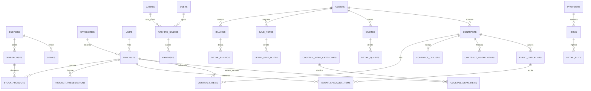
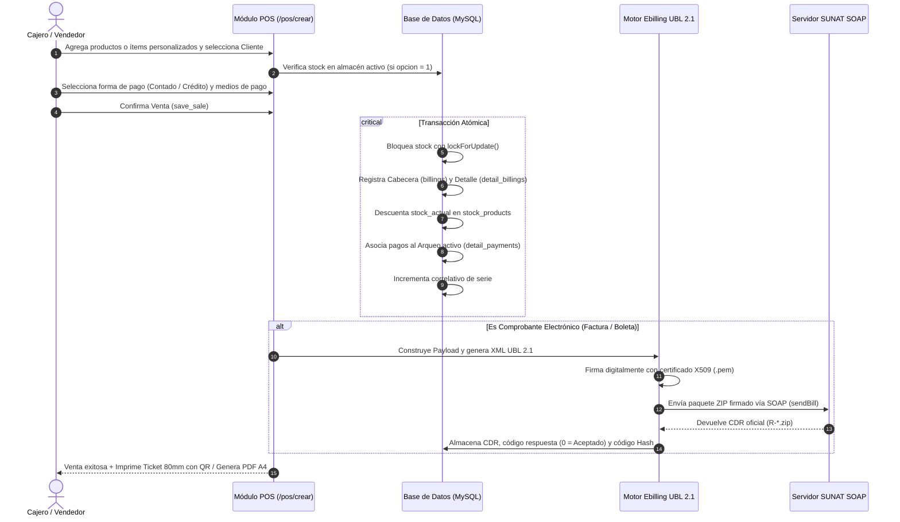
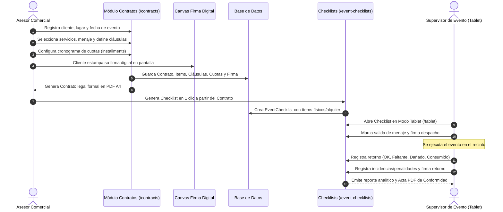
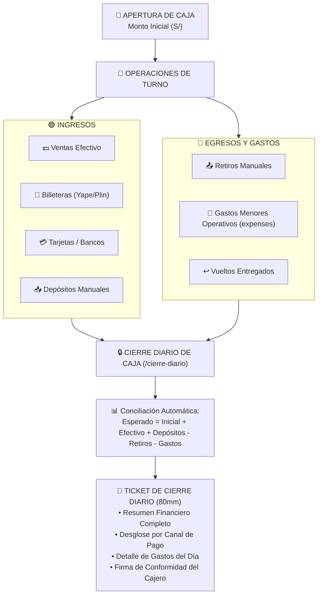

# PDR - Documento de Requerimientos y Diseño de Producto (Product Design & Requirements)
## Shipibo ERP: Sistema Integral de Gestión Comercial, Control Multi-Almacén, Eventos y Facturación Electrónica SUNAT

---

## Control del Documento

| Campo | Detalle |
| :--- | :--- |
| **Proyecto** | Shipibo ERP (EasyStock Commercial Edition) |
| **Emisor / Empresa Base** | MYTEMS E.I.R.L. (RUC 20601744158) / Configurable Multi-Empresa On-Premise |
| **Versión del Documento** | 3.0.0 |
| **Estado** | Aprobado / Producción |
| **Framework Base** | Laravel 10.x / PHP 8.2+ (Optimizado para PHP 8.3.6) |
| **Base de Datos** | MySQL 8.0+ / MariaDB 10.4+ Transaccional InnoDB |
| **Normativa Tributaria** | SUNAT UBL 2.1 (Resolución de Superintendencia N° 097-2012/SUNAT y modificatorias) + GRE API REST |
| **Última Actualización** | Octubre 2026 |

---

## 1. Resumen Ejecutivo y Visión del Producto

### 1.1 Propósito
**Shipibo ERP** es una plataforma integral de gestión empresarial (ERP comercial y operativo) diseñada específicamente para el entorno comercial y normativo peruano. Centraliza de manera monolítica y de alto rendimiento el ciclo comercial y operativo de punta a punta:
* **Abastecimiento**: Compras formales a proveedores con control anti-duplicados y costeo automático.
* **Control Físico y Valorado de Inventarios**: Existencias por multi-almacén, presentaciones con factores de conversión, stock fraccionario/decimal, menaje y herramientas de alquiler (`rentable`), y kardex multivariable.
* **Ventas y Punto de Venta (POS)**: Terminal táctil y lector de código de barras (`onScan`), soporte para ítems personalizados al vuelo, descuentos globales prorrateados, modalidades contado y crédito en cuotas.
* **Comprobantes Electrónicos y Fiscalidad SUNAT**: Emisión directa de Facturas (`01`), Boletas (`03`), Notas de Crédito (`07`), Notas de Débito (`08`) en estándar UBL 2.1 con firma digital XML-DSig y recepción de CDR, además de Guías de Remisión Electrónica Remitente (`09`) vía API REST OAuth2.
* **Notas de Venta Internas**: Circuito paralelo para comprobantes de control administrativo con descuento unificado de stock y cuadre de caja.
* **Gestión de Eventos y Catering**: Contratos de prestación de servicios con firma digital en pantalla (Canvas) o archivo, cronograma de cuotas financieras con alertas de vencimiento, checklists interactivos de despacho y retorno en modo Tablet, y carta digital de coctelería touch.
* **Tesorería y Control de Efectivo**: Apertura de cajas, registro de ventas segregado por medio de pago (Efectivo, Tarjetas, Yape, Plin, Transferencias), depósitos y retiros manuales, control de gastos menores (`expenses`) y módulo de Cierre Diario consolidado con ticket térmico de liquidación.

### 1.2 Objetivos Estratégicos
1. **Cumplimiento Tributario SUNAT Autónomo**: Cero dependencia de proveedores externos de facturación (PSE/OSE). Generación, firma digital X509 y transmisión directa mediante SOAP/REST con resguardo persistente de XML y CDR.
2. **Trazabilidad Absoluta**: Registro granular de cada movimiento físico (Kardex) y monetario (Arqueos) asociado al usuario, almacén activo, caja física y documento origen.
3. **Flexibilidad Comercial y Operativa**: Capacidad de manejar venta rápida minorista, cotizaciones formales convertibles en 1 clic, servicios para eventos con menaje de retorno y múltiples almacenes interconectados.
4. **Diseño Multi-Dispositivo**: Módulos optimizados para escritorio, monitores POS táctiles, y tablets operativas para control en vivo de barras y eventos.

---

## 2. Arquitectura de Software y Stack Tecnológico

```
┌────────────────────────────────────────────────────────────────────────────────────────┐
│                                CAPA DE PRESENTACIÓN (UI)                               │
│  Blade Templates + Bootstrap 5.x + DataTables + Select2 + SweetAlert2 + Canvas + Touch │
└───────────────────────────────────────────┬────────────────────────────────────────────┘
                                            │ HTTP / AJAX / JSON / Multipart
┌───────────────────────────────────────────▼────────────────────────────────────────────┐
│                            CAPA DE APLICACIÓN (LARAVEL 10)                             │
│  ┌─────────────────────────┐ ┌─────────────────────────┐ ┌──────────────────────────┐ │
│  │    Controladores MVC    │ │   Validaciones / Rules  │ │   Middleware / Guards    │ │
│  │ (POS, CPE, Contratos,   │ │ (RUC/DNI, Stock, IGV,   │ │ (Auth, Spatie RBAC,      │ │
│  │  Checklists, Cocteles)  │ │  Importaciones Excel)   │ │  Selector Establecimiento│ │
│  └────────────┬────────────┘ └────────────┬────────────┘ └────────────┬─────────────┘ │
│               │                           │                           │               │
│  ┌────────────▼───────────────────────────▼───────────────────────────▼─────────────┐ │
│  │                             SERVICIOS ESPECIALIZADOS                             │ │
│  │  - Motor UBL 2.1 (InvoiceXmlBuilder, XmlSigner, SunatSoapClient, CdrParser)      │ │
│  │  - Motor DomPDF (Tickets térmicos 80mm y formatos A4 Portrait/Landscape)         │ │
│  │  - Consulta RENIEC / SUNAT (Consumo REST Factiliza API con fallback)             │ │
│  │  - Gestor de Kardex, Stock Fraccionario y Presentaciones Múltiples               │ │
│  │  - Import / Export Excel (Maatwebsite / Spatie fast-excel compatible)            │ │
│  └────────────────────────────────────────┬─────────────────────────────────────────┘ │
└───────────────────────────────────────────┼────────────────────────────────────────────┘
                                            │ Eloquent ORM
┌───────────────────────────────────────────▼────────────────────────────────────────────┐
│                                 CAPA DE PERSISTENCIA                                   │
│                     Base de Datos MySQL 8.0+ / MariaDB Transaccional                   │
│         60+ Tablas Normalizadas (CPE, Clientes, Productos, Almacenes, Contratos,       │
│                Checklists, Gastos, Cuotas, Menús de Cócteles, Kardex)                  │
└────────────────────────────────────────────────────────────────────────────────────────┘
```

### 2.1 Componentes Técnicos y Dependencias Clave
* **Lenguaje y Framework**: PHP 8.2+ / 8.3.6 con Laravel 10.x.
* **Base de Datos**: MySQL 8.0 InnoDB con soporte estricto de transacciones ACID (`DB::transaction`) y bloqueos pesimistas (`lockForUpdate()`).
* **Seguridad y Permisos**: `spatie/laravel-permission` con segregación de roles (`SUPERADMIN`, `ADMIN`, `VENDEDOR`, `CAJERO`, `ALMACENERO`).
* **Motor PDF**: `barryvdh/laravel-dompdf` adaptado a rollos térmicos de 80mm (`[0, 0, 226.77, variable]`) y formato formal A4 portrait/landscape (`setPaper('A4', 'portrait')`).
* **Códigos QR y Barras**: `simplesoftwareio/simple-qrcode` y escáner óptico mediante `onscan.min.js`.
* **Conversión Numérica**: `luecano/numero-a-letras` para expresión del importe total en letras según normativa SUNAT.
* **Firmado Digital**: Firma XML-DSig nativa mediante certificados `.pfx` o `.pem` con clave privada.

---

## 3. Esquema Relacional de Base de Datos



---

## 4. Especificación Funcional de Módulos (Requerimientos)

### 4.1 Módulo de Configuración de Empresa (`/business`)
* **Propósito**: Administrar los datos fiscales del contribuyente emisor y las credenciales electrónicas.
* **Campos Requeridos**: RUC (11 dígitos), Razón Social, Nombre Comercial, Dirección Fiscal, Ubigeo de 6 dígitos, Departamento, Provincia, Distrito, Teléfono, Correo.
* **Credenciales SUNAT**:
  - Usuario Secundario SOL y Contraseña SOL (para SOAP de Facturas, Boletas, NC, ND).
  - Certificado Digital (`.pfx` / `.pem` con clave privada).
  - Client ID y Client Secret para API REST Guías de Remisión Electrónica (GRE).
  - Modo de Operación: Pruebas (Beta) / Producción.
* **Branding**: Carga y redimensionamiento del logotipo oficial de la empresa para facturas, cotizaciones, contratos y cartas de coctelería.

---

### 4.2 Módulo de Clientes y Proveedores (`/clients`, `/providers`)
* **Propósito**: Directorio único de personas naturales y jurídicas con validación fiscal.
* **Tipos de Documento Homologados SUNAT**:
  - `1`: DNI (8 dígitos).
  - `6`: RUC (11 dígitos).
  - `4`: Carnet de Extranjería.
  - `7`: Pasaporte.
  - `0`: No Domiciliado / Sin Documento.
* **Consulta Rápida Automatizada**: Conexión al servicio Factiliza API para autocompletar Nombres / Razón Social y Dirección Fiscal a partir del número de DNI o RUC.
* **Normalización**: Estructura compatible para evitar duplicidad de entidades.

---

### 4.3 Módulo de Inventario, Productos y Multi-Almacén (`/products`, `/warehouses`, `/kardex`)
* **Separación Operativa Producto vs. Servicio**:
  - `opcion = 1` (Producto físico / bien tangible): Descuenta stock por almacén en cada venta, nota de venta o salida; suma stock en compras y recepciones de traslado.
  - `opcion = 2` (Servicio intangible): No gestiona stock físico ni kardex, pero cumple con las reglas tributarias de IGV y facturación.
* **Herramientas de Alquiler / Menaje (`rentable` / `es_alquilable`)**:
  - Distingue insumos consumibles de activos retornables para eventos (copas, cocteleras, mobiliario).
* **Presentaciones y Equivalencias (`product_presentations`)**:
  - Permite configurar múltiples presentaciones por producto (cajas, paquetes, display, botellas) con factor de conversión para descuento automático exacto de stock.
* **Stock Fraccionario Decimal**:
  - Campo `stock_actual` decimal a 4 dígitos para control por peso (kg), volumen (litros) o fraccionamiento de insumos.
* **Multi-Almacén**:
  - Cada almacén posee su tabla de existencias independiente (`stock_products`).
  - Alertas de stock mínimo.
  - Carga masiva de existencias e importación/exportación vía Excel (.xlsx).
  - Ajuste directo de stock e incremento rápido por escáner de código de barras (`barcode_sum`).
* **Kardex Físico y Valorado**:
  - Trazabilidad cronológica de entradas, salidas y saldos continuos (*Running Balance*) vinculados a Compras, Ventas, Notas de Venta, Traslados y Saldo Inicial.

---

### 4.4 Módulo de Compras y Abastecimiento (`/buys`)
* **Propósito**: Registrar el ingreso de mercadería desde proveedores formales, afectando costos y stock.
* **Características**:
  - Registro de tipo de documento del proveedor (Factura, Boleta, Guía o Nota de Compra).
  - Selección de almacén de destino del inventario.
  - Protección contra duplicidad de compras (`idproveedor` + `serie` + `correlativo`).
  - Actualización atómica en `stock_products` y actualización del costo referencial (`precio_compra`) en el catálogo.

---

### 4.5 Módulo de Cotizaciones y Proformas (`/quotes`)
* **Propósito**: Emitir propuestas comerciales formales sin descuento de stock ni afectación contable inmediata.
* **Funcionalidades**:
  - Generación de proformas numeradas en formato A4 y Ticket con código QR.
  - Envío automático de proforma por correo electrónico al cliente.
  - Conversión en 1 clic: Transforma la cotización directamente en una Venta POS trasladando todos los ítems sin reescritura.

---

### 4.6 Módulo de Contratos de Servicios con Firma Digital y Cuotas (`/contracts`)
* **Propósito**: Formalizar acuerdos de prestación de servicios, catering, eventos y suministros.
* **Características Principales**:
  - **Numeración Única**: Formato anual correlativo (ej. `CON-2026-0001`).
  - **Comparecencia de Partes**: Identificación formal de El Prestador y El Cliente.
  - **Datos del Evento**: Fecha programada, hora de inicio, lugar y recinto del evento.
  - **Detalle de Ítems y Precios**: Selección desde catálogo o ítems a medida, con cálculo en vivo de subtotal, IGV (18%) y total en letras (`NumeroALetras`).
  - **Cláusulas Dinámicas**: Editor interactivo de cláusulas legales con reordenamiento, adición, eliminación y carga de plantillas estándar.
  - **Captura de Firma Digital**: Canvas interactivo táctil/mouse para firma en pantalla y opción de carga de archivo de firma (PNG/JPG).
  - **Cronograma de Cuotas Financieras (`contract_installments`)**:
    - División del contrato en cuotas con porcentaje, monto y fecha de vencimiento.
    - Badges visuales de alerta automática: "Cuota Vencida", "Vence Hoy", "Al Día", "Pagado".
    - Registro de amortizaciones/pagos con medio de pago y referencia (`POST /contracts/installments/{id}/pay`).
  - **Exportación en PDF A4**: Descarga formal del contrato legal con firmas incrustadas y cláusulas completas.
  - **Integración con Checklists**: Enlace directo para generar la lista de control de montaje del evento en 1 clic.

---

### 4.7 Módulo de Checklists Operativos de Eventos (`/event-checklists`)
* **Propósito**: Controlar el despacho y retorno físico de menaje, insumos y herramientas para eventos.
* **Funcionalidades**:
  - **Generación Automática**: A partir de cualquier contrato aprobado (`/event-checklists/contract/{contractId}/generate`), importando los ítems físicos y de alquiler.
  - **Fase de Despacho (Salida)**: Verificación táctil de cada ítem transportado al recinto del evento.
  - **Fase de Retorno (Desmontaje)**: Control post-evento de cada ítem con clasificación de estado:
    - `ok`: Devuelto en óptimas condiciones.
    - `faltante`: No regresó al almacén.
    - `daniado`: Requiere reparación.
    - `quebrado`: Daño irreparable / reposición.
    - `consumido`: Insumo utilizado en el evento.
  - **Costos y Penalidades**: Asignación de costos de reposición por ítems dañados o faltantes con notas de incidencia.
  - **Modo Tablet Táctil (`/event-checklists/{id}/tablet`)**: Interfaz táctil full-screen optimizada para supervisores en campo, con toggles de un toque, adición rápida de ítems y switches masivos.
  - **Firmas de Conformidad**: Captura de firmas digitales del responsable de montaje y del responsable de desmontaje.
  - **Reporte y Acta PDF**: Generación web de resumen de incidencias y descarga de acta formal de conformidad en PDF DomPDF.

---

### 4.8 Módulo de Menú de Cócteles y Carta Digital Táctil (`/cocktail-menu`)
* **Propósito**: Gestionar la carta de coctelería y barra para eventos, degustaciones y atención en vivo.
* **Funcionalidades**:
  - **Gestión de Cócteles**: Nombre, cristalería recomendada, garnish/decoración, descripción sensorial, precio y fotografía de alta resolución.
  - **Clasificación y Atributos**: Organización por categorías dinámicas (`cocktail_menu_categories`), flags de "Cóctel de Autor" e "Ítem Destacado".
  - **Vinculación con Catálogo**: Enlace opcional con productos tipo servicio (`opcion = 2`) para integración con facturación.
  - **Modo Tablet Touch (`/cocktail-menu/tablet`)**: Interfaz interactiva de alta fidelidad para clientes o bartenders:
    - Navegación táctil horizontal/vertical por categorías.
    - Switch en vivo para mostrar/ocultar precios según el tipo de evento (barra libre vs. venta por copa).
    - Modal detallado de ficha técnica con notas de cata y garnish.

---

### 4.9 Módulo de Punto de Venta (POS) y Notas de Venta (`/pos`, `/salenotes`)
* **Terminal POS Moderno (`/pos/crear`)**:
  - Interfaz reactiva adaptada para monitores táctiles y lectores de código de barras (`onScan`).
  - Búsqueda instantánea de productos con información de stock en el almacén activo.
  - Soporte de **Ítems Personalizados al Vuelo (`add-custom-item`)**: Permite vender conceptos especiales no catalogados definiendo descripción, unidad libre y precio.
  - Medios de pago múltiples en una sola transacción: Efectivo con cálculo de vuelto, Yape, Plin, Tarjeta, Transferencia o Mixto.
  - Condiciones de pago: Contado y Crédito con desglose de cuotas.
  - Descuentos globales prorrateados automáticamente por ítem.
* **Emisión Dual**:
  - **Nota de Venta (`salenotes`)**: Control interno sin reporte SUNAT, con serie `NV01`, descuento físico de stock e ingreso a caja.
  - **Comprobante Electrónico (CPE)**: Envío inmediato a la cola de timbrado UBL 2.1.
* **Impresión**: Generación instantánea de tickets térmicos de 80mm con código QR y hojas A4.

---

### 4.10 Módulo de Facturación Electrónica SUNAT UBL 2.1 (`/billings`)
* **Tipos de CPE Soportados**:
  - Factura Electrónica (`01`): Exige RUC válido en estado Habido/Activo y razón social.
  - Boleta de Venta Electrónica (`03`): Para consumidor final con DNI o sin documento (hasta límites normativos).
  - Nota de Crédito Electrónica (`07`): Con catálogo 09 de tipos de nota de crédito (anulación total, corrección de texto, descuento global, etc.) con restitución automática de stock si aplica.
  - Nota de Débito Electrónica (`08`): Intereses por mora, penalidades o aumento de valor.
* **Proceso de Emisión y Transmisión**:
  1. Construcción del XML UBL 2.1 (`InvoiceXmlBuilder`).
  2. Firma digital XML-DSig con certificado digital (`XmlSigner`).
  3. Empaquetado ZIP y transmisión vía SOAP al WebService SUNAT (`SunatSoapClient`).
  4. Extracción y análisis del CDR oficial (`CdrParser`), obteniendo código de respuesta y observaciones.
  5. Cálculo del código Hash (DigestValue) e incrustación de código QR oficial.
  6. Descarga directa de archivos XML firmados y CDR (`/billings/{id}/xml`, `/billings/{id}/cdr`).
* **Endpoints API REST (`/api/sunat/*`)**:
  - `POST /api/sunat/validate`: Validador tributario de comprobantes.
  - `GET /api/sunat/billings/{billing}/payload`: Extracción de estructura JSON UBL.
  - `POST /api/sunat/billings/{billing}/dispatch`: Timbrado y despacho directo por API.

---

### 4.11 Módulo de Guías de Remisión Electrónica (`/shipment-guides`)
* **Normativa**: SUNAT GRE Remitente mediante API REST Oficial con autenticación OAuth2.
* **Características**:
  - Motivos de traslado estándar (Venta, Compra, Traslado entre establecimientos, Devolución).
  - Modalidades de transporte: Privado (vehículo y conductor propio) o Público (empresa de transportes).
  - Puntos de partida y llegada con validación de códigos de Ubigeo.
  - Representación impresa en Ticket 80mm y Hoja A4 con código QR.

---

### 4.12 Módulo de Traslados entre Almacenes (`/transferorders`)
* **Propósito**: Control de tránsito físico de inventario entre almacenes de la misma empresa.
* **Fases Operativas**:
  - Registro de orden con almacén despacho y receptor.
  - Estado Pendiente / En Tránsito: Descuenta el stock del almacén despacho.
  - Recepción / Confirmación: Valida la llegada e incrementa el stock en el almacén receptor.
  - Cancelación de orden sin afectación de inventario.
  - Impresión de guía de traslado interno en PDF.

---

### 4.13 Módulo de Arqueo de Cajas, Control de Gastos y Cierre Diario (`/archingcash`, `/archingcash/cierre-diario`)
* **Apertura de Turno**: Registro del monto inicial de caja (fondo fijo) por usuario y almacén.
* **Operaciones de Turno**:
  - Ingresos automáticos provenientes de ventas en POS distribuidos por medio de pago.
  - Registro de Depósitos o Entradas extraordinarias de efectivo.
  - Registro de Retiros o Salidas de efectivo.
* **Control de Gastos Operativos Menores (`expenses`)**:
  - Registro detallado de egresos durante el turno con tipo y número de comprobante de compra menor, motivo, monto, método de pago y beneficiario.
* **Cierre Diario de Caja Consolidado (`/archingcash/cierre-diario`)**:
  - Resumen en tiempo real del saldo esperado versus el saldo físico.
  - Conciliación de ventas por clasificación (pagado, pendiente, devuelto, anulado).
  - Impresión de Ticket de Cierre Diario en 80mm con liquidación financiera completa.

---

### 4.14 Módulo Conmutador de Establecimiento Activo (`/establishment`)
* **Propósito**: Permitir al usuario autenticado seleccionar el almacén/establecimiento físico donde se encuentra operando.
* **Características**:
  - Conmutador accesible desde la cabecera del sistema.
  - Almacenamiento en sesión (`session('selected_warehouse_id')`) y actualización en `users.idalmacen`.
  - Filtro automático de stock, ventas, cajas y reportes limitados al almacén activo.

---

### 4.15 Módulo de Reportes Contables y Analítica (`/billings/reports`, `/reportes`)
* **Registro de Ventas Oficial SUNAT**: Reporte fiscal consolidado con base imponible (Gravada, Exonerada, Inafecta), IGV y Total, exportable a PDF y Excel.
* **Reporte de Comprobantes Emitidos**: Monitoreo de estado de comprobantes electrónicos (Aceptados, Rechazados, Pendientes).
* **Reporte de Notas de Crédito**: Detalle de ajustes fiscales y anulaciones.
* **Ventas por Producto y Categoría**: Rotación de inventario y productos estrella.
* **Ventas por Medio de Pago**: Desglose financiero por canal (Efectivo, Tarjetas, Yape, Plin, Transferencias).

---

## 5. Flujos Operativos del Sistema (Diagramas de Proceso)

### 5.1 Flujo de Venta y Facturación Electrónica SUNAT


### 5.2 Flujo de Contratos, Cuotas y Checklists Operativos


### 5.3 Flujo de Arqueo y Cierre Diario de Caja con Gastos


---

## 6. Reglas de Negocio Críticas

1. **Invariabilidad del Stock por Servicios**: Todo ítem con `opcion = 2` está exento de validación y descuento de stock, sin importar el almacén seleccionado.
2. **Exclusividad de Caja Abierta**: Un cajero no puede registrar ventas POS ni notas de venta si no cuenta con una sesión de arqueo activa (`estado = 1`) en su almacén activo.
3. **Validación de Identidad Fiscal para Facturas**: Para la emisión de Facturas Electrónicas (`01`), el cliente debe registrarse obligatoriamente con Tipo de Documento RUC (`6`) de 11 dígitos numéricos válidos.
4. **Anulaciones de Comprobantes**:
   - Comprobantes fiscales con menos de 72 horas pueden anularse mediante Nota de Crédito Electrónica tipo `01` (Anulación de la operación), restituyendo automáticamente las existencias al almacén original.
   - Las Notas de Venta internas solo pueden ser anuladas por usuarios autorizados, reintegrando inmediatamente el stock al almacén correspondiente.
5. **Autonumeración de Contratos y Checklists**:
   - Contratos: `CON-{AÑO}-{CORRELATIVO_4_DIGITOS}`.
   - Checklists: `CHK-{AÑO}-{CORRELATIVO_4_DIGITOS}`.
6. **Integridad de Cuotas**: El monto total sumado de las cuotas financieras de un contrato debe ser exactamente igual al monto total del contrato.
7. **Control de Menaje y Penalidades**: Todo ítem reportado como `faltante`, `daniado` o `quebrado` en el checklist post-evento genera un cargo por penalidad asociado al costo de reposición.

---

## 7. Requerimientos No Funcionales (NFR)

| Dimensión | Especificación y Criterio de Aceptación |
| :--- | :--- |
| **Rendimiento** | Tiempo de respuesta en creación de ventas POS < 1.0 segundos en red local; respuesta de timbrado y generación de PDF < 3.5 segundos sujeta a latencia de servidores SUNAT. |
| **Disponibilidad** | Operatividad 24/7 en servidor local o VPS Linux con colas de reintento para contingencias de red hacia WebServices SUNAT. |
| **Seguridad** | Cifrado Bcrypt para contraseñas; control de acceso RBAC con Spatie; protección CSRF en todos los formularios web y sanitización de consultas SQL vía PDO/Eloquent. |
| **Usabilidad Táctil** | Interfaces responsivas adaptadas para monitores POS táctiles (1024x768 o superior), tablets Android/iPad para checklists en campo y smartphones. |
| **Respaldo y Persistencia** | Almacenamiento persistente de archivos XML, CDRs, firmas digitales y PDFs en la carpeta `public/files/` y exportaciones automáticas de base de datos MySQL. |

---

## 8. Matriz Completa de Controladores, Modelos, Métodos, Rutas y Vistas

La siguiente matriz documenta la totalidad de los módulos y componentes del sistema:

| Módulo / Funcionalidad | Controlador | Métodos Principales | Modelos Asociados | Vistas Blade | Prefijo de Ruta |
| :--- | :--- | :--- | :--- | :--- | :--- |
| **Autenticación y Sesión** | `LoginController` | `index`, `login`, `logout` | `User` | `resources/views/login.blade.php` | `/`, `/login/*` |
| **Panel Principal y Métricas** | `HomeController` | `index`, `ventasMensuales`, `reporteIngresos`, `metodosPagoVentas` | `Billing`, `SaleNote`, `DetailPayment` | `admin.home` | `/home/*` |
| **Conmutador de Almacén** | `WarehouseSelectorController` | `index`, `store` | `Warehouse`, `User` | `resources/views/establishment.blade.php` | `/establishment/*` |
| **Configuración de Empresa** | `BusinessController` | `index`, `load_ubigeo`, `load_provinces`, `load_districts`, `load_logo`, `save_info`, `save_sunat` | `Business`, `Country`, `Department`, `Province`, `District` | `admin.business.home` | `/business/*` |
| **Control de Cajas Físicas** | `CashController` | `index`, `get`, `save`, `detail`, `store`, `delete` | `Cash` | `admin.cashes.list` | `/cashes/*` |
| **Medios de Pago** | `PayModeController` | `index`, `get`, `save`, `detail`, `store`, `delete` | `PayMode` | `admin.paymodes.list` | `/pay-modes/*` |
| **Series y Correlativos** | `SerieController` | `index`, `get`, `save`, `detail`, `store`, `delete` | `Serie`, `TypeDocument`, `Cash` | `admin.series.list` | `/series/*` |
| **Países y Monedas** | `CountryController` | `index`, `get`, `save`, `detail`, `store`, `delete` | `Country` | `admin.countries.list` | `/countries/*` |
| **Clientes y Padrón Fiscal** | `ClientController` | `index`, `get`, `searchDocument`, `save`, `detail`, `store`, `delete` | `Client`, `IdentityDocumentType` | `admin.clients.list` | `/clients/*` |
| **Proveedores de Insumos** | `ProviderController` | `index`, `get`, `searchDocument`, `save`, `detail`, `store`, `delete` | `Provider`, `Client` | `admin.providers.list` | `/providers/*` |
| **Categorías de Productos** | `CategoryController` | `index`, `get`, `save`, `detail`, `store`, `delete` | `Category` | `admin.categories.list` | `/categories/*` |
| **Productos y Presentaciones** | `ProductController` | `index`, `get`, `save`, `detail`, `view_detail`, `store`, `delete`, `bulkDelete`, `savePresentations`, `download`, `exportAllExcel`, `upload` | `Product`, `ProductPresentation`, `Category`, `Unit`, `IgvTypeAffection`, `StockProduct` | `admin.products.list`, `modal-register`, `modal-add-cart`, `export_all_excel` | `/products/*` |
| **Almacenes y Stock Físico** | `WarehouseController` | `index`, `get`, `save`, `detail`, `store`, `delete`, `products`, `list_products`, `get_prod_warehouse`, `get_detail_products`, `save_product_stock`, `barcode_sum`, `save_products_all`, `detail_sum`, `sum_stock`, `detail_stock`, `store_stock`, `delete_stock`, `export_products`, `upload_excel_products` | `Warehouse`, `StockProduct`, `Product` | `admin.warehouses.list`, `admin.warehouses.products.list` | `/warehouses/*` |
| **Kardex Multi-Almacén** | `KardexController` | `index` | `StockProduct`, `Product`, `Warehouse`, `Buy`, `Billing`, `SaleNote`, `TransferOrder` | `admin.kardex.index` | `/kardex/*` |
| **Compras y Abastecimiento** | `BuyController` | `index`, `create`, `get`, `save`, `detail`, `store`, `delete`, `load_cart`, `get_product`, `add_product`, `delete_product`, `store_product`, `load_providers`, `get_product_idwarehouse`, `print`, `test_pdf` | `Buy`, `DetailBuy`, `Provider`, `Warehouse`, `Product` | `admin.buys.list`, `admin.buys.create`, `admin.buys.pdf` | `/buys/*` |
| **Cotizaciones y Proformas** | `QuoteController` | `index`, `get`, `create`, `edit`, `detail`, `convert_to_sale`, `save`, `load_clients`, `load_cart`, `add_product`, `delete_product`, `store_product`, `get_product_update`, `store_product_update`, `get_product_idwarehouse`, `gen_update`, `print`, `print_a4`, `print_ticket`, `send_mail`, `get_product` | `Quote`, `DetailQuote`, `Client`, `Product` | `admin.quotes.list`, `admin.quotes.create`, `admin.quotes.edit`, `admin.quotes.pdf` | `/quotes/*` |
| **Contratos de Servicios y Cuotas** | `ContractController` | `index`, `get`, `create`, `store`, `edit`, `update`, `destroy`, `detail`, `print_a4`, `download_pdf`, `pay_installment` | `Contract`, `ContractClause`, `ContractItem`, `ContractInstallment`, `Client`, `Product` | `admin.contracts.list`, `admin.contracts.create`, `admin.contracts.edit`, `admin.contracts.pdf` | `/contracts/*` |
| **Checklists Operativos Eventos** | `EventChecklistController` | `index`, `get`, `generateFromContract`, `tablet`, `updateItem`, `addItem`, `bulkToggle`, `report`, `pdfReport`, `destroy` | `EventChecklist`, `EventChecklistItem`, `Contract`, `Product` | `admin.event_checklists.index`, `tablet`, `report`, `pdf` | `/event-checklists/*` |
| **Menú de Cócteles y Carta Touch** | `CocktailMenuController` | `index`, `get`, `detail`, `store`, `delete`, `toggle_status`, `store_category`, `delete_category`, `tablet` | `CocktailMenuItem`, `CocktailMenuCategory`, `Product`, `Business` | `admin.cocktail_menu.index`, `admin.cocktail_menu.tablet` | `/cocktail-menu/*` |
| **Punto de Venta Táctil (POS)** | `PosController` | `index`, `create`, `get`, `search_product`, `add_product_search`, `load_cart`, `add_product`, `add_product_barcode`, `delete_product`, `clear_cart`, `store_product`, `open_modal`, `save_sale`, `search_units`, `add_custom_item`, `delete_custom_item` | `Billing`, `DetailBilling`, `SaleNote`, `DetailSaleNote`, `DetailPayment`, `Product`, `Serie`, `Client`, `Cash`, `ArchingCash` | `admin.pos.list`, `admin.pos.home`, `ticket_document`, `ticket_sn` | `/pos/*` |
| **Notas de Venta Internas** | `SaleNoteController` | `index`, `get`, `print_ticket`, `print_a4`, `send_mail`, `anulled` | `SaleNote`, `DetailSaleNote`, `DetailPayment`, `StockProduct` | `admin.sale_notes.list`, `admin.sale_notes.pdf` | `/salenotes/*` |
| **Facturación Electrónica UBL 2.1** | `BillingController` | `index`, `get`, `credit_notes_index`, `get_credit_notes`, `debit_notes_index`, `get_debit_notes`, `create_credit_note`, `create_debit_note`, `print_ticket`, `print_a4`, `download_xml`, `download_cdr`, `dispatch` | `Billing`, `DetailBilling`, `TypeDocument`, `CreditNoteType`, `DebitNoteType`, `StockProduct` | `admin.billings.list`, `credit_notes_list`, `debit_notes_list` | `/billings/*` |
| **Guías de Remisión GRE** | `ShipmentGuideController` | `index`, `create`, `get`, `searchUbigeo`, `save`, `detail`, `print_ticket`, `print_a4` | `ShipmentGuide`, `ShipmentGuideItem`, `Business`, `Client` | `admin.shipment_guides.list`, `admin.shipment_guides.create`, `ticket`, `pdf` | `/shipment-guides/*` |
| **Traslados entre Almacenes** | `TransferOrderController` | `index`, `create`, `get`, `load_serie`, `load_warehouse_office`, `load_warehouse_dispatch`, `load_cart`, `search_product`, `detail_product`, `add_product`, `delete_product`, `store_product`, `save`, `detail`, `anulled`, `move`, `print`, `test_pdf` | `TransferOrder`, `DetailTransferOrder`, `Warehouse`, `StockProduct` | `admin.transfer_orders.list`, `admin.transfer_orders.create`, `pdf` | `/transferorders/*` |
| **Arqueo y Cierre de Caja** | `ArchingCashController` | `index`, `get`, `save`, `store`, `delete`, `close`, `detail_cash`, `detail_cashes`, `get_summary`, `save_deposit`, `save_withdrawal`, `print_resumen`, `print_summary` | `ArchingCash`, `Cash`, `DetailPayment`, `Billing`, `SaleNote` | `admin.arching_cashes.list`, `admin.arching_cashes.ticket` | `/archingcash/*` |
| **Cierre Diario de Caja y Gastos** | `DailyCashClosingController` | `index`, `sales_data`, `expenses_data`, `store_expense`, `delete_expense`, `close_cash`, `print_ticket` | `Expense`, `ArchingCash`, `Cash`, `DetailPayment`, `Billing`, `SaleNote` | `admin.arching_cashes.daily_closing`, `daily_closing_ticket`, `modal-expense` | `/archingcash/cierre-diario/*` |
| **Usuarios del Sistema** | `UserController` | `index`, `get`, `save`, `detail`, `store`, `delete`, `view_role`, `update` | `User`, `Cash`, `Warehouse` | `admin.users.list` | `/users/*` |
| **Roles y Permisos Spatie** | `RoleController` | `index`, `get`, `save`, `detail`, `store`, `delete` | Spatie `Role`, `Permission` | `admin.roles.list` | `/roles/*` |
| **Reportes Tributarios CPE** | `BillingReportController` | `salesRegister`, `getSalesRegister`, `salesRegisterPdf`, `salesRegisterExcel`, `billingDocuments`, `getBillingDocuments`, `billingDocumentsPdf`, `billingDocumentsExcel`, `creditNotes`, `getCreditNotes`, `creditNotesPdf`, `creditNotesExcel` | `Billing`, `DetailBilling`, `TypeDocument`, `CreditNoteType` | `admin.reports.billings.sales_register`, `billing_documents`, `credit_notes`, `excel`, `pdf` | `/billings/reports/*` |
| **Reportes Comerciales y Ventas** | `ReportSalesController` | `index`, `getSalesReport`, `salesByProductIndex`, `getSalesByProduct` | `Billing`, `SaleNote`, `DetailBilling`, `DetailSaleNote`, `Product` | `admin.reports.sales.index`, `sales_product` | `/reportes/ventas/*`, `/by-product` |
| **Reportes por Medios de Pago** | `ReportPaymentController` | `index`, `getSalesByPaymentMethod` | `DetailPayment`, `PayMode` | `admin.reports.payments.index` | `/reportes/pagos/*` |
| **API REST SUNAT Dispatch** | `SunatValidationController`, `SunatBillingPayloadController`, `SunatDispatchController` | `__invoke` | `Billing`, `DetailBilling`, `Business` | *JSON Endpoints* | `/api/sunat/*` |

---

<p align="center">
  <b>MYTEMS E.I.R.L. &bull; Shipibo ERP</b><br>
  Documento Oficial de Requerimientos y Diseño de Producto (PDR v3.0.0 - Octubre 2026)
</p>
